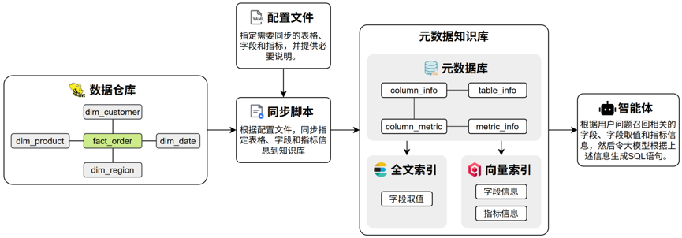
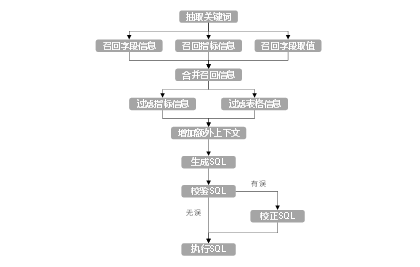

# 知数 · QuerySense

面向业务数据分析的自然语言问数服务，基于元数据检索与 LangGraph 工作流实现 Text-to-SQL，提供从问题理解、SQL 生成到数据库查询的完整处理链路。

QuerySense 将数据库结构、字段语义、业务指标与实际取值组织为元数据知识库，为大模型提供 SQL 生成上下文。服务通过 HTTP 接口接收问题，流式返回执行进度与结构化查询结果，可接入数据分析页面、业务系统或智能助手。

当前业务模型围绕订单、客户、商品、日期和地区组织，覆盖销售额统计、品类分析与客户分组查询等场景。

## 核心能力

- **业务元数据管理**，通过 YAML 定义表结构、字段角色、业务描述、别名和指标口径，建立元数据库及检索索引。
- **多路检索召回**，结合字段与指标的向量检索、字段取值的全文检索，为问题匹配相关数据结构与业务语义。
- **查询上下文构建**，合并召回信息、补充主外键，筛选相关表和指标，并加入日期及数据库环境信息。
- **SQL 生成与校正**，基于 LangGraph 编排生成、校验、修正与执行节点，利用数据库反馈修正查询语句。
- **流式交互与日志追踪**，通过 FastAPI 提供节点进度、结果和异常事件，结合异步数据访问与请求 ID 追踪查询过程。

## 系统架构



系统由元数据构建与在线查询两条流程组成。构建流程将数据库结构和业务描述转换为可检索的知识，在线流程按问题检索相关信息并执行查询。

| 组件 | 职责 |
| --- | --- |
| MySQL 业务库 | 保存订单事实表与客户、商品、日期、地区维度表，承载实际数据查询 |
| MySQL 元数据库 | 保存表、字段、指标及其关联，维护业务语义与结构信息 |
| Qdrant | 保存字段、指标名称及描述和别名的向量，提供语义检索 |
| Elasticsearch | 对指定维度字段的实际取值建立全文索引，提供取值匹配 |
| LangGraph | 管理节点状态与流程路由，组织检索、生成、校验和执行 |
| FastAPI | 提供 HTTP 查询接口、运行依赖管理与流式响应 |

## 问数流程



用户问题依次经过关键词提取、多路召回、信息合并、相关性过滤和上下文补充，再由模型生成 SQL。系统通过 `EXPLAIN` 校验语句，校验异常后调用模型修正一次，再进入执行节点。

工作流以 `DataAgentState` 管理查询状态，通过 `DataAgentContext` 注入数据访问依赖，通过 `runtime.stream_writer` 输出事件。节点路由集中定义于 `app/agent/graph.py`，业务处理与存储访问分别组织于 Service 和 Repository 层。

## 技术栈

| 模块 | 技术 |
| --- | --- |
| 服务与语言 | Python 3.11+、FastAPI |
| 模型与编排 | LangChain、LangGraph、OpenAI 兼容接口 |
| 数据访问 | MySQL 8.0、SQLAlchemy、asyncmy |
| 信息检索 | Qdrant、Elasticsearch 8.19.10、IK、Jieba |
| 向量服务 | BAAI/bge-large-zh-v1.5、Text Embeddings Inference |
| 配置与部署 | OmegaConf、Loguru、uv、Docker Compose |

## 目录结构

```text
data-agent/
├── app/
│   ├── agent/             # 工作流、节点、状态与模型调用
│   ├── api/               # HTTP 路由、请求模型、依赖注入与生命周期
│   ├── clients/           # 数据库与外部服务客户端管理
│   ├── conf/              # 配置定义与加载
│   ├── core/              # 日志与请求上下文
│   ├── models/            # SQLAlchemy ORM 模型
│   ├── entities/          # 业务实体
│   ├── prompt/            # 提示词加载工具
│   ├── repositories/      # MySQL、Qdrant、Elasticsearch 数据访问
│   ├── scripts/           # 元数据知识库构建脚本
│   └── services/          # 问数与知识库构建业务逻辑
├── conf/                  # 应用配置与业务元数据配置
├── docker/                # 基础服务编排、初始化 SQL 与模型目录
├── docs/images/           # 架构图与流程图
├── prompts/               # 静态提示词模板
├── main.py                # FastAPI 入口
├── pyproject.toml         # 项目依赖
├── uv.lock                # 依赖锁定文件
└── README.md
```

## 快速启动

### 环境与配置

运行环境为 Python 3.11+、uv、Docker 和 Docker Compose，模型服务需提供 OpenAI 兼容接口。

| 配置文件 | 内容 |
| --- | --- |
| `conf/app_config.yaml` | MySQL、Qdrant、ES、Embedding 地址，模型参数与日志配置 |
| `conf/meta_config.yaml` | 业务表、字段、别名、角色与指标口径 |
| `docker/docker-compose.yaml` | 基础服务端口、数据库凭据与数据卷 |

应用配置位于 `conf/app_config.yaml`，基础服务配置位于 `docker/docker-compose.yaml`，运行前填写对应环境的连接信息。

业务库账号配置查询权限，元数据库账号配置读写权限。`bge-large-zh-v1.5` 的向量维度为 1024，需与 `qdrant.embedding_size` 一致。

Embedding 模型存放于 `docker/embedding/bge-large-zh-v1.5/`，包含权重、模型配置与分词器文件。Elasticsearch 使用与 8.19.10 匹配的 IK 插件。[模型下载](https://huggingface.co/BAAI/bge-large-zh-v1.5)

模型权重通过 Git LFS 管理，克隆仓库后执行 `git lfs pull` 获取完整文件。

在项目根目录安装依赖。

```bash
uv sync
```

随后激活项目虚拟环境。Windows PowerShell 使用 `.\.venv\Scripts\Activate.ps1`，Linux/macOS 使用 `source .venv/bin/activate`。

### 启动基础服务

在项目根目录进入 `docker` 目录执行。

```bash
cd docker
docker compose up -d
cd ..
```

MySQL 首次初始化空数据卷时执行 `docker/mysql/` 下的 SQL，创建业务库 `dw` 和元数据库 `meta`。数据库与 Embedding 服务就绪后执行知识库构建。

### 创建元数据知识库

在项目根目录执行。

```bash
python -m app.scripts.build_meta_knowledge --conf conf/meta_config.yaml
```

构建任务同步表、字段与指标元数据，同时生成向量索引和字段取值索引。重复执行前需确认已有元数据与索引状态。

### 启动 FastAPI

在项目根目录执行，CLI 自动发现 `main.py` 中的应用。

```bash
fastapi dev
```

开发服务默认地址为 `http://127.0.0.1:8000`，接口文档位于 `/docs`。

## 接口说明

### 自然语言查询

`POST /api/query`，请求类型为 `application/json`。

```json
{
  "query": "统计华北地区的销售总额"
}
```

响应媒体类型为 `text/plain`，使用 `data: <JSON>` 加空行分隔事件。以下展示事件格式，数据为示例。

```text
data: {"type": "progress", "step": "提取关键词", "status": "running"}

data: {"type": "progress", "step": "提取关键词", "status": "success"}

data: {"type": "result", "data": [{"销售总额": "12345.67"}]}

```

| 事件类型 | 字段 | 含义 |
| --- | --- | --- |
| `progress` | `step`、`status` | 节点进度，状态为 `running`、`success` 或 `error` |
| `result` | `data` | 查询结果数组，空结果为 `[]` |
| `error` | `message` | 查询异常说明 |

调用端按完整事件解析 JSON，并处理流内的异常事件。

